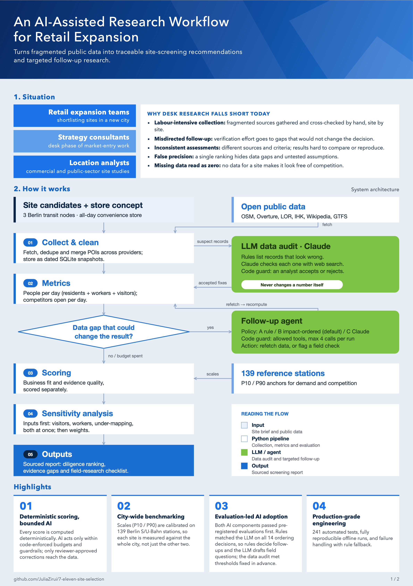
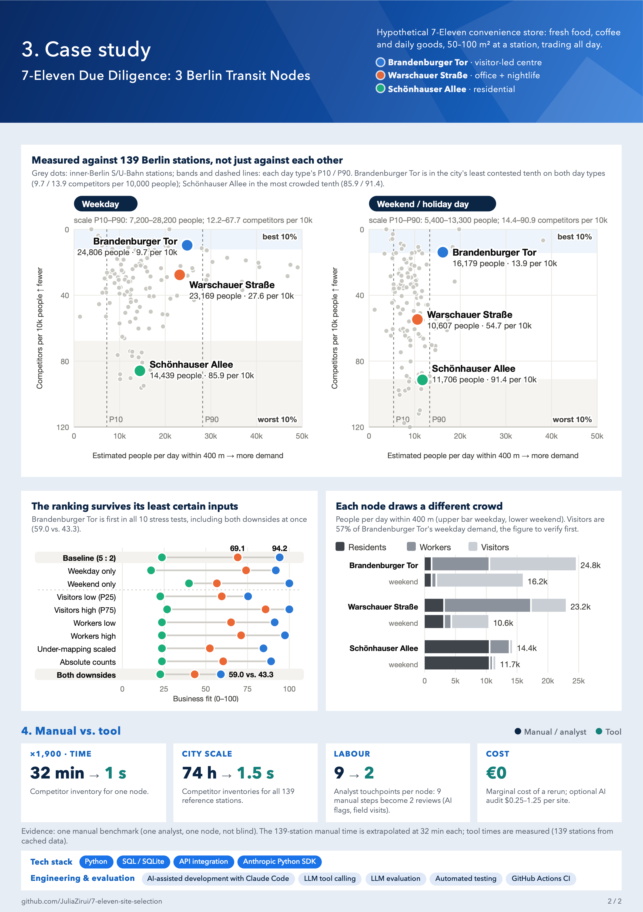
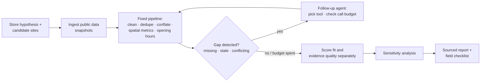

# Transit-Node Site Screening — Berlin Case Study

[](https://github.com/JuliaZirui/7-eleven-site-selection/actions/workflows/tests.yml)

A desk-research tool for retail expansion teams and the consultants who advise them. Before money is spent on field visits, it ranks candidate sites from public data. For each ranking it shows how far the evidence supports it, whether it holds up when its least certain inputs are pushed to their plausible limits, and what has to be checked on site.

> **Disclaimer.** This is a hypothetical case I set up myself. It does not represent an actual mandate from 7-Eleven or a market-entry plan by 7-Eleven. The tool ranks sites by *priority for on-site diligence*. It does not forecast revenue, and it does not decide where a store should open.

## Portfolio (two pages)

A two-page summary of the project: the situation, how the system works, the case study and the manual-vs-tool comparison. [Download the PDF](portfolio/portfolio.pdf).

<p>
  <a href="portfolio/portfolio.pdf"></a>
  <a href="portfolio/portfolio.pdf"></a>
</p>

## Who it is for

- **Retail expansion / site-selection teams** shortlisting locations in a new city.
- **Strategy consultants** doing the desk-research phase of a market-entry engagement.

Both work at the same point in the process: there are several candidate locations, and budget and time to visit only a few of them.

## The problem

Field diligence is expensive: footfall counts, competitor walks, landlord conversations. So the desk research that comes before it decides where that money goes. Today that research is usually done by hand, and it has four weaknesses:

1. **Slow.** Building one competitor inventory for one site took 32 minutes by hand in this project's benchmark.
2. **Inconsistent.** Two analysts, or one analyst on two days, produce different lists, and nobody can rerun the work.
3. **Missing data gets read as "zero".** If a source has no data for a site, the site can look like it has no competition.
4. **False certainty.** The output is a single ranking, with no indication of how much of it rests on weak data or on an arbitrary weighting.

## What it delivers

For each candidate site, a sourced report containing:

| Output | What it answers |
| --- | --- |
| **Business fit** (0–100) | How well does public data on demand and competition match the store concept? |
| **Evidence quality** (0–100), scored separately | How far can that fit score be trusted? Measured by source corroboration, freshness, completeness and mapping consistency. The two scores are never added together. |
| **Sensitivity analysis, inputs first** | Does the ranking survive its least certain inputs at their plausible limits, one at a time and together: the visitor conversion, verified worker headcounts, competitor under-mapping, and how competition is measured? Weight checks (named scenarios, ±50% shifts, 10,000 random weightings) are reported too. With two pillars they can only reveal a trade-off between demand and competition (see *Why input sensitivity comes first*). |
| **Differentiation hypotheses** | Rule-generated hypotheses to test, e.g. "weekday 16–19 thinly served". The time windows behind them are listed, not scored. These are hypotheses, not findings. |
| **Evidence gaps and a field-research checklist** | What the data cannot settle, and exactly what to verify on site. |

Demand and competition are scored against the distribution across **139 inner-Berlin S/U-Bahn stations** (P10/P90 anchors). Competition is scored over the whole day, separately for weekdays and weekends: competitors open that day per 10,000 people. Time windows are not scored: the store trades all day, and no public source measures footfall by time window. So each site is measured against the city's stations, not just ranked against the other two candidates.

## How it works

The design principle is a **fixed computation pipeline plus a bounded follow-up agent**, not an agent that owns the decision.



| Layer | Responsibility |
| --- | --- |
| **Program** (deterministic) | Cleaning, multi-source POI conflation, spatial calculations, opening-hours parsing (incl. overnight spans), scoring, stop conditions |
| **Follow-up agent** (bounded) | Detects gaps that affect the conclusions (missing, stale or conflicting data), picks a refetch tool or flags the gap for field research, and stays within a call budget of 4 calls per run and 2 per site. It is triggered by data problems, never by a raw count such as "fewer than 8 shops". The decision step is a pluggable policy: an impact-ordered rule (default), the original fixed rule, or Claude (`claude-opus-5-5`). Whatever the policy proposes passes a guard in plain code (allowed tool, budget, no retry of a failed source) before it runs. |
| **Data-plausibility audit** (LLM, review only) | Before scoring, deterministic rules list the raw records most likely to be wrong (a company's whole headcount filed at one address, a famous venue's visitors far beyond its capacity, a large workplace missing from the registry, a miscategorised or duplicate competitor). Claude (`claude-sonnet-5-5`, with web search) checks each one and cites its sources. It **never changes a number**: findings pass a guard in plain code and go to a review queue, and only rows a person accepts reach the correction tables that scoring reads. Skipped without API credentials; the report then marks the sites as unaudited. |

**Data sources** (all open, no paid APIs): OpenStreetMap and Overture Maps (competitors, conflated across providers); Berlin LOR / MSS 2025 (residents); IHK Gewerbedaten (workplaces); Wikidata + Wikipedia pageviews + VBB GTFS (visitor draw); DB InfraGO station price classes (a same-tier check, not footfall).

Foursquare OS Places is **implemented but not connected**. The client, normalisation and conflation code exist (`src/fsq_client.py`, `poi_pipeline.py`) and run only when `HF_TOKEN` is set for the gated dataset. No Foursquare snapshot is in the database, and the 139-station anchors use OSM and Overture only. Foursquare listings still reach the competitor set indirectly, as one of Overture's upstream datasets.

**Traceability:** SQLite, six tables. Snapshots are only ever appended, never overwritten. "Data as of" and "fetched on" are stored separately. Unknown values are flagged, never set to 0. Every number in the report cites the snapshot it came from.

## Case study: three Berlin transit nodes

The store concept: fresh food, coffee and convenience goods, 50–100 m², trading all day, for everyone within walking distance: residents, people working nearby and visitors ([store_hypothesis.md](store_hypothesis.md)). No customer segment and no time of day is preset as the core; the question is how strong the competition is at each node and how much business potential the public data show. (Early versions positioned the store around the commute peaks; that was dropped because no public source measures when trade falls.) The three candidates share the **same DB station price class** (Preisklasse 4, *Stationspreisliste 2026*). That is a station tier, not measured footfall:

- DB InfraGO assigns the class from a points score with six elements: platform edges and maximum platform length (20% each), passengers and train stops (20% each), step-free access (5%) and service staff (15%).
- Passengers are rail boardings and alightings on a weekday as reported by the train operators, in wide bands (10,000–49,999 is one band). They cover DB rail only, here the S-Bahn, not the U-Bahn.
- 73 of Berlin's 133 DB stations are class 4, from Hackescher Markt to Ahrensfelde.

The shared class rules out a node in a different tier: Zoologischer Garten (class 2) was replaced for that reason. It does not make the three nodes' volumes equal, and footfall by time window is not published (see Limitations). They differ in customer mix:

| Node | Customer profile | Business fit | Fit, low visitor conversion | Fit, competitors scaled to best mapping rate | Fit, both at once | Evidence quality |
| --- | --- | --- | --- | --- | --- | --- |
| Brandenburger Tor | Visitor-led, city centre | 94.2 | 75.3 | 84.5 (counts ×2.30) | 59.0 | 72.9 (verify first) |
| Warschauer Straße | Office + nightlife mix | 69.1 | 59.5 | 52.4 (counts ×1.60) | 43.3 | 76.4 (verify first) |
| Schönhauser Allee | Residential daily shopping | 23.7 | 22.7 | 23.7 (×1) | 22.7 | 90.0 (adequate) |

Figures from [analysis run #26](reports/site_report_run26_20261008T181455Z.md) (2026-10-08, `scoring_v8`; same scores as run #22; later runs changed only the report: input checks first, the joint downside check, and the store concept without a commuter positioning). Two changes since run #20:
- **Competition is scored over the whole day** instead of in four time windows: the morning and evening baskets merged, open on a weekday or a weekend day, per 10,000 of that day type's people. Anchors were recalibrated on the same 139 stations (weekday P90 → P10: 67.7 → 12.2; weekend 90.9 → 14.4); the demand anchors reproduce exactly. Weekday competitors per 10,000 people: Brandenburger Tor 9.7, Warschauer Straße 27.6, Schönhauser Allee 85.9.
- **The second audit review round is applied.** Records that are not competitors, closed or duplicated are excluded: 2 at Brandenburger Tor (29 → 27 competitors) and 9 at Schönhauser Allee (149 → 140). Two public employers missing from the IHK registry are added at Brandenburger Tor: the ARD-Hauptstadtstudio (~250) and the federal anti-discrimination agency (~35).

Fit moves 92.9 → 94.2 (Brandenburger Tor) and 64.2 → 69.1 (Warschauer Straße); Schönhauser Allee stays at 23.7. The ranking and every input check are unchanged.

**Reading:**
- **Brandenburger Tor is the diligence priority.** It stays first when each uncertain input is moved to its plausible limit. Across the interquartile range of the visitor conversion, at the low end it still leads 75.3 to 59.5. It also stays first across the verified range of on-site workers, with competition counted in absolute numbers instead of per head, and with every node's competitor counts scaled up to the best-mapped node's rate.
- **It also stays first with both main downsides at once.** With visitors at the low conversion *and* competitor counts scaled for under-mapping, it leads 59.0 to 43.3. Warschauer Straße then leads on demand, but it would rank first only with demand weighted above 86%. The low conversion also answers "is a visitor worth as much as a resident or a worker?": it cuts converted visitors to about 0.45×, close to counting each visitor as half a person.
- **Its lead rests on two things to verify first.**
  - **Competition.** OSM appears to under-map its competitors: 27 mapped against 66 IHK-registered food businesses (41%, against 94% at Schönhauser Allee). The stress test multiplies its competitor counts by 2.30 and Warschauer Straße's by 1.60. Brandenburger Tor's fit falls from 94.2 to 84.5, and it still leads 84.5 to 52.4. It would lose #1 only if its competitors were under-counted about 5.9×. The advantage is therefore not a mapping artifact at the measured gap, but it is smaller than the baseline shows. Verifying the competitor count is still the first item on its field checklist.
  - **Demand.** About 57% of its weekday demand is visitors, converted from Wikipedia pageviews; the ranking holds across the conversion's interquartile range, but only a footfall count settles it. About 6,600 of its workers are public-sector staff estimated by hand (range 5,100–8,200); the other two nodes' public employers have not been inventoried the same way.
- **Schönhauser Allee is lower priority in this screening round.** Under the current demand proxy and competition measures, it faces the highest relative competitive pressure of the three, and its evidence is the strongest. Its all-day competitor counts are above the P90 of the 139 reference stations on weekdays and weekends, with or without dividing by demand, and so are its counts in each unscored time window.
- **The ranking does not depend on dividing competition by demand.** The baseline scores competitors per 10,000 people, so demand also enters the competition pillar. Re-scored with absolute competitor counts in the 400 m circle (anchored on the same 139 stations), the order is unchanged (89.1 / 60.4 / 23.7).

### Why input sensitivity comes first

Business fit has two pillars, demand and competition, so a weighting is a single number *w* (demand's share). Between any two nodes the fit difference is linear in *w*. The order can therefore change at most once between *w* = 0 and *w* = 1, and only if each node leads one pillar. A node that leads both pillars ranks first at every weighting. The 10,000 random weightings, the named scenarios and the ±50% shifts then all return the same answer, and that answer adds nothing to the pillar scores themselves. That is the case here: Brandenburger Tor leads both demand (88.5 vs 73.2 and 47.4) and competition (100.0 vs 65.1 and 0.0). "100% of random weightings" is a consequence of that, not separate evidence of robustness. Even when the pillars do trade off, the random-weighting share only says where the single crossover weight falls on a uniform prior.

What can overturn this ranking is a wrong input, not a different weight. So the report leads with the checks that move inputs: the visitor conversion's interquartile range, the verified worker ranges, competitor counts scaled for under-mapping, the visitor and competitor downsides together, and competition measured without the demand denominator. Weight checks remain in §4 of the report, for the case where a future node set does trade off between the pillars.

## Validation

- **241 automated tests, all passing, run by GitHub Actions on every push (Python 3.9 and 3.12).** They cover missing data, duplicate records, API failures (49 mocked failure paths) and overnight opening hours, plus scoring, report, agent-guard and LLM-policy tests (mocked client, plus one round trip through the real SDK with an intercepted transport).
- **End-to-end reproducibility.** A rerun with the network blocked reproduces every score, the ranking and the sensitivity results exactly. Compute takes about 1 second, with no LLM tokens and €0 marginal cost.
- **Manual vs. tool benchmark** on one node ([comparison/manual_vs_tool.md](comparison/manual_vs_tool.md)):
  - Speed: 32 minutes by hand, about 1 second for the tool once the data is fetched.
  - Coverage: neither inventory was complete. The tool found about twice as many competitors, including several confirmed by three providers that the manual pass missed. The manual pass found 4 places that no open source listed, and got far better opening-hours coverage.
  - The most useful output was the list of disagreements, which became the field checklist.
  - The comparison also exposed two tool defects: an unmerged cross-provider duplicate and two Overture category errors. Both are now fixed in the conflation step, two of the three records by general rules that also run on the 139 reference stations ([comparison/data_quality_fixes.md](comparison/data_quality_fixes.md)). Brandenburger Tor's morning-peak count falls from 16 to 13 and its fit moves from 92.7 to 92.9. The ranking and the 100% random-weighting share are unchanged; its evidence quality drops from 75.4 to 73.9, because the under-mapping signal gets stronger.
- **Follow-up policy comparison** ([comparison/policy_eval.md](comparison/policy_eval.md)). Does an LLM decide better than rules which data gaps to spend live calls on? 16 scenarios, with the expected decisions committed before any policy ran ([comparison/policy_scenarios.md](comparison/policy_scenarios.md)):
  - Rule baseline: 10/16. Impact-ordered rule: 14/16. LLM: 16/16 in all 5 runs, no guard rejections, $0.019 per run ($1.50 for the whole evaluation).
  - On ordering, the impact rule and the LLM tie (14/14). The LLM's measurable edge is declining calls that cannot change the decision (2 scenarios), plus much more specific field questions. The expected decisions and the LLM's prompt share an author, which limits how much the LLM's score can show.
  - Decision ([comparison/policy_findings.md](comparison/policy_findings.md)): the impact rule becomes the default. The LLM stays optional, and its proposed role is writing field questions.
- **Data-plausibility audit** ([comparison/audit_findings.md](comparison/audit_findings.md), plan: [plan_llm_data_audit.md](plan_llm_data_audit.md)). Can an LLM replace the manual "does this number make sense?" pass? Answer key, holdout, control and decision thresholds committed before any audit code; the prompt frozen before the holdout ran:
  - Holdout: 4/6 known issues caught in at least 2 of 3 runs; false alarms per run 1 (holdout) and 3 (control). Both criteria sit exactly on the pre-registered thresholds, so the rule says adopt, narrowly. The main evidence (three items not shaped by earlier fixes) is 2/3.
  - Three stations nobody had checked: the analyst confirmed 57 of 58 flags, 38 of them issues a 20-minute manual scan had missed. The scan found 46 issues; about 27 never reached the audit, because the candidate rules did not list them. The rules, not the LLM, are the bottleneck.
  - $14.12 for the whole evaluation; about $1 per site per refresh.

## Limitations

- **Three sites, one per customer profile.** The tool answers "which of these sites first?", not "are visitor-led sites better than residential ones?". Answering the second question would need several sites per profile.
- **Demand is proxied, not counted.** Visitor numbers are estimated from Wikipedia pageviews, calibrated on 37 attractions with published counts. Station footfall is not published by time window, so no window is scored: the field checklist counts footfall in the morning, at midday and in the evening to check the demand estimate. Rent, storefront availability and supply chain are out of scope and listed as unscored.
- **The store concept is hard-coded.** Competitor categories, the diagnostic time windows and the 400 m radius encode a convenience-store format. The radius is a general industry convention, not a 7-Eleven standard. No 7-Eleven standard could be found in public sources.
- **The LLM policy only decides follow-ups, never scores.** Scoring stays deterministic and reproducible; the default follow-up policy is the impact-ordered rule, which needs no API. With three nodes there are few real budget decisions (today's data has none), so the policy comparison runs on constructed scenarios. The value grows with the planned citywide run.
- **The data audit sees only what its candidate rules list.** Most competitor problems a manual scan finds (restaurants listed as cafés, closed shops) never reach it. Its flags were labelled by one analyst who could see the auditor's reasons.
- **The manual benchmark is a single, non-blind data point.** One node, one analyst (who also built the tool), one pass.

## Next steps

1. **Citywide run.** Run the full pipeline end to end on all 139 reference stations; the pipeline already computes their core metrics.
2. **Configurable store concept.** Move the competitor taxonomy, time windows and weights into a config file, so other small-format retail concepts can reuse the same pipeline.
3. **A second manual benchmark** on Warschauer Straße or Schönhauser Allee, so hand-verified corrections are not limited to one node, plus a spot check of the 28 near-duplicate merges at reference stations.
4. **Hybrid follow-up.** Rules decide what to follow up; the LLM only writes the field question for each flag ([comparison/policy_findings.md](comparison/policy_findings.md)).
5. **Wider audit candidate rules** for competitor categories and closed shops, the measured gap of the data audit; any new rule needs a fresh holdout ([comparison/audit_findings.md](comparison/audit_findings.md)).
6. **LLM opening-hours extraction** from competitors' own websites, behind a coverage go/no-go check ([plan_llm_opening_hours.md](plan_llm_opening_hours.md)).

## Repository map

| Path | Contents |
| --- | --- |
| [store_hypothesis.md](store_hypothesis.md) | Store concept and European benchmark chains |
| [site_candidates.md](site_candidates.md) | Business question, node selection, data-verification log |
| [project_plan_v3.md](project_plan_v3.md) | Original v1 scope, architecture, 7-day plan |
| [plan_llm_tool_selection.md](plan_llm_tool_selection.md) | Plan for the LLM follow-up policy and its evaluation (done) |
| [plan_llm_data_audit.md](plan_llm_data_audit.md) | Plan for the LLM data-plausibility audit, its pre-registration and amendments (done; adopted) |
| [plan_llm_opening_hours.md](plan_llm_opening_hours.md) | Plan for LLM opening-hours extraction (not started) |
| `src/` | Ingestion clients, pipelines, conflation, scoring, follow-up agent and policies, report generator, policy evaluation |
| `tests/` | Test suites and the test runner (`run_day6.py`) |
| `reports/` | Latest site report, score file and test log (earlier runs are kept in the database, not in the repo) |
| `db/` | SQLite database, schema and raw source snapshots ([GTFS note](db/raw/vbb_gtfs/README.md)) |
| `.github/workflows/` | CI: test suite + offline reproducibility check |
| [portfolio/](portfolio/README.md) | Two-page portfolio (PDF and page images), architecture diagram, case-study charts, and the scripts that build them |
| `comparison/` | Manual vs. tool benchmark and the data-quality fixes it led to; follow-up policy scenarios, results and findings; data-audit answer key, prompt log, labels, evaluation, findings, and the review queue |

Requires Python 3.9+. Everything below runs offline from the committed database and snapshots:

```bash
pip install -r requirements.txt
python3 tests/run_day6.py
```

Optional, for the LLM follow-up policy and the data-plausibility audit (needs an Anthropic API key, in the shell or in a git-ignored `.env` as `ANTHROPIC_API_KEY=...`): `pip install -r requirements-llm.txt`. `refresh` then runs the audit before scoring (about $1 per site; `--no-audit` skips it). Review the flags in `comparison/audit_review_queue.csv` (set `review_status` to `accepted` or `rejected`, your name in `reviewer`), then write the accepted ones to the correction tables with `python3 src/audit_apply.py --write` (without `--write` it only shows what it would do).
