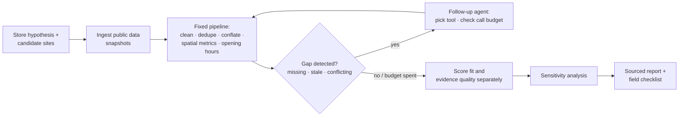

# Transit-Node Site Screening — Berlin Case Study

[](https://github.com/JuliaZirui/7-eleven-site-selection/actions/workflows/tests.yml)

A desk-research tool for retail expansion teams and the consultants who advise them. Before money is spent on field visits, it ranks candidate sites from public data. For each ranking it shows how far the evidence supports it, whether it holds up under different weightings, and what has to be checked on site.

> **Disclaimer.** This is a hypothetical case I set up myself. It does not represent an actual mandate from 7-Eleven or a market-entry plan by 7-Eleven. The tool ranks sites by *priority for on-site diligence*. It does not forecast revenue, and it does not decide where a store should open.

## Who it is for

- **Retail expansion / site-selection teams** shortlisting locations in a new city.
- **Strategy consultants** doing the desk-research phase of a market-entry engagement.

Both work at the same point in the process: there are several candidate locations, and budget and time to visit only a few of them.

## The problem

Field diligence is expensive: footfall counts, competitor walks, landlord conversations. So the desk research that comes before it decides where that money goes. Today that research is usually done by hand, and it has four weaknesses:

1. **Slow.** Building one competitor inventory for one site took 32 minutes by hand in this project's benchmark.
2. **Inconsistent.** Two analysts, or one analyst on two days, produce different lists, and nobody can rerun the work.
3. **Missing data gets read as "zero".** If a source has no data for a site, the site can look like it has no competition.
4. **False certainty.** The output is a single ranking, with no indication of how much of it rests on weak data or on an arbitrary weighting.

## What it delivers

For each candidate site, a sourced report containing:

| Output | What it answers |
| --- | --- |
| **Business fit** (0–100) | How well does public data on demand and competition match the store concept? |
| **Evidence quality** (0–100), scored separately | How far can that fit score be trusted? Measured by source corroboration, freshness, completeness and mapping consistency. The two scores are never added together. |
| **Weight sensitivity** | Does the ranking survive named scenarios, ±50% weight shifts and 10,000 random weightings? Which conclusions are robust, and which depend on the client's strategic priorities? |
| **Differentiation hypotheses** | Rule-generated hypotheses to test, e.g. "morning peak under-supplied for its demand". These are hypotheses, not findings. |
| **Evidence gaps and a field-research checklist** | What the data cannot settle, and exactly what to verify on site. |

Demand and competition are scored against the distribution across **139 inner-Berlin S/U-Bahn stations** (P10/P90 anchors). So each site is measured against the city's stations, not just ranked against the other two candidates.

## How it works

The design principle is a **fixed computation pipeline plus a bounded follow-up agent**, not an agent that owns the decision.



| Layer | Responsibility |
| --- | --- |
| **Program** (deterministic) | Cleaning, multi-source POI conflation, spatial calculations, opening-hours parsing (incl. overnight spans), scoring, stop conditions |
| **Follow-up agent** (bounded) | Detects gaps that affect the conclusions (missing, stale or conflicting data), picks a refetch tool or flags the gap for field research, and stays within a call budget of 4 calls per run and 2 per site. It is triggered by data problems, never by a raw count such as "fewer than 8 shops". The decision step is a pluggable policy: a fixed rule (default), an impact-ordered rule, or Claude (`claude-opus-5-5`). Whatever the policy proposes passes a guard in plain code (allowed tool, budget, no retry of a failed source) before it runs. |

**Data sources** (all open, no paid APIs): OpenStreetMap, Overture Maps and Foursquare OS Places (competitors, conflated across providers); Berlin LOR / MSS 2025 (residents); IHK Gewerbedaten (workplaces); Wikidata + Wikipedia pageviews + VBB GTFS (visitor draw); DB InfraGO station price classes (a check that the sites see comparable transit volumes).

**Traceability:** SQLite, six tables. Snapshots are only ever appended, never overwritten. "Data as of" and "fetched on" are stored separately. Unknown values are flagged, never set to 0. Every number in the report cites the snapshot it came from.

## Case study: three Berlin transit nodes

The store concept: fresh food, coffee and convenience goods, 50–100 m², with a morning (7–9) and an evening (16–19) commuter peak. The three candidates all have the **same DB station price class** (Preisklasse 4), so their transit volumes are comparable. They differ in customer mix:

| Node | Customer profile | Business fit | Evidence quality | Ranked #1 in random weightings |
| --- | --- | --- | --- | --- |
| Brandenburger Tor | Visitor-led, city centre | 100.0 | 75.4 (verify first) | 100% |
| Warschauer Straße | Office + nightlife mix | 88.6 | 76.6 (verify first) | 0% |
| Schönhauser Allee | Residential daily shopping | 17.3 | 90.4 (adequate) | 0% |

**Reading:**
- **Brandenburger Tor is the diligence priority.** It ranks first under every weighting tested.
- **Its lead depends on two things to verify first.** At the low end of the visitor estimate the gap to Warschauer Straße narrows to under 3 points. Its competitors also appear under-mapped in OSM: 32 mapped competitors against 66 IHK-registered food businesses. So its competition advantage may partly be a data artifact, and verifying the competitor count is the first item on its field checklist.
- **Schönhauser Allee is the clearest deprioritization.** Its evidence is the strongest of the three, and competition per head there is saturated.

## Validation

- **153 automated tests, all passing, run by GitHub Actions on every push (Python 3.9 and 3.12).** They cover missing data, duplicate records, API failures (49 mocked failure paths) and overnight opening hours, plus scoring, report, agent-guard and LLM-policy tests (mocked client, plus one round trip through the real SDK with an intercepted transport).
- **End-to-end reproducibility.** A rerun with the network blocked reproduces every score, the ranking and the Monte Carlo shares exactly. Compute takes about 1 second, with no LLM tokens and €0 marginal cost.
- **Manual vs. tool benchmark** on one node ([comparison/manual_vs_tool.md](comparison/manual_vs_tool.md)):
  - Speed: 32 minutes by hand, about 1 second for the tool once the data is fetched.
  - Coverage: neither inventory was complete. The tool found about twice as many competitors, including several confirmed by three providers that the manual pass missed. The manual pass found 4 places that no open source listed, and got far better opening-hours coverage.
  - The most useful output was the list of disagreements, which became the field checklist. The comparison also exposed two tool defects (an unmerged cross-provider duplicate and Overture category errors); both are logged for v2.
- **Follow-up policy comparison** ([comparison/policy_eval.md](comparison/policy_eval.md)). Does an LLM decide better than rules which data gaps to spend live calls on? 16 scenarios, with the expected decisions committed before any policy ran ([comparison/policy_scenarios.md](comparison/policy_scenarios.md)):
  - Rule baseline: 10/16. Impact-ordered rule: 14/16. Both fail exactly the scenarios predicted from their code. The two they cannot pass are "do nothing" cases, where no live call is justified.
  - LLM policy: implemented and tested against a mocked client; the paid evaluation run (5 repeats per scenario) is pending.

## Limitations

- **Three sites, one per customer profile.** The tool answers "which of these sites first?", not "are visitor-led sites better than residential ones?". Answering the second question would need several sites per profile.
- **Demand is proxied, not counted.** Visitor numbers are estimated from Wikipedia pageviews, calibrated on 37 attractions with published counts. Station footfall by time window is not published. Rent, storefront availability and supply chain are out of scope and listed as unscored.
- **The store concept is hard-coded.** Competitor categories, peak windows and the 400 m radius encode a convenience-store format. The radius is a general industry convention, not a 7-Eleven standard. No 7-Eleven standard could be found in public sources.
- **The LLM policy only decides follow-ups, never scores.** Scoring stays deterministic and reproducible; the rule policy remains the offline default. With three nodes there are few real budget decisions (today's data has none), so the policy comparison runs on constructed scenarios. The value grows with the planned citywide run.
- **The manual benchmark is a single, non-blind data point.** One node, one analyst (who also built the tool), one pass.

## Next steps

1. **Citywide run.** Run the full pipeline end to end on all 139 reference stations; the pipeline already computes their core metrics.
2. **Configurable store concept.** Move the competitor taxonomy, peak windows and weights into a config file, so other small-format retail concepts can reuse the same pipeline.
3. **Data-quality fixes found by the benchmark.** Merge duplicates that appear under different names, and filter Overture category errors by confidence.

## Repository map

| Path | Contents |
| --- | --- |
| [store_hypothesis.md](store_hypothesis.md) | Store concept and European benchmark chains |
| [site_candidates.md](site_candidates.md) | Business question, node selection, data-verification log |
| [project_plan_v3.md](project_plan_v3.md) | Scope, architecture, 7-day plan |
| `src/` | Ingestion clients, pipelines, conflation, scoring, follow-up agent, report generator |
| `tests/` | Test suites and the test runner (`run_day6.py`) |
| `reports/` | Latest site report, score file and test log (earlier runs are kept in the database, not in the repo) |
| `db/` | SQLite database, schema and raw source snapshots ([GTFS note](db/raw/vbb_gtfs/README.md)) |
| `.github/workflows/` | CI: test suite + offline reproducibility check |
| `comparison/` | Manual vs. tool benchmark |

Requires Python 3.9+. Everything below runs offline from the committed database and snapshots:

```bash
pip install -r requirements.txt
python3 tests/run_day6.py
```
