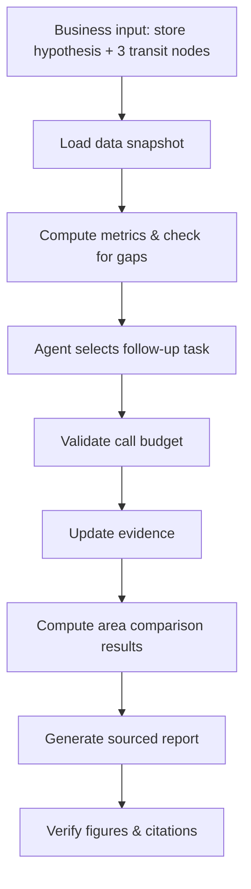

# Berlin Convenience Store Site-Selection Assistant — Project Plan v3 (7-Eleven Hypothetical Case)

2026-09-22

> **Status (2026-10-02).** This is the original v1 plan, kept for the record. v1 is complete; the work after it (multi-source competitors, demand in people per day, weekday/weekend scoring, CI, the follow-up policy comparison) is logged in [site_candidates.md](site_candidates.md) and summarized in the [README](README.md). Statuses below are updated; the scope text is not.

Using a hypothetical 7-Eleven entry into Berlin as the case, this project builds a transit-node screening and site-diligence Agent prototype as a portfolio project.

## Store Hypothesis & Business Question

This is a self-constructed hypothetical client case. **It does not represent an actual mandate or market-entry plan from 7-Eleven.** The first version only delivers a transit-node shortlist; it does not answer "should 7-Eleven enter Germany" or forecast profitability.

The store hypothesis (product/service assumptions, target customers, operating hours, store format) and the European benchmark cases live in [store_hypothesis.md](store_hypothesis.md).

The core business question, the final candidate transit nodes (with DB Preisklasse verification), the business analysis scope, and the data verification log live in [site_candidates.md](site_candidates.md).

Coordinate anchors for the three nodes and the Day 1 to-dos (search radius, `LocationInput.time_window` rework; both done) are in [site_candidates.md](site_candidates.md).

## Minimum Viable Scope (MVP)

### Must-have (v1 delivery boundary)

- A store-hypothesis document (category, customers, operating-hours assumptions)
- A side-by-side comparison of the three candidate transit nodes
- Two core data sources: OSM + LOR population statistics
- A fixed computation pipeline: cleaning, deduplication, spatial calculations, opening-hours parsing (including overnight spans), scoring, database writes, stop conditions
- Bounded, agent-driven follow-up queries (triggered by missing/stale/conflicting data — not a rule like "expand the radius if fewer than 8 POIs")
- A SQLite six-table schema, with data-as-of date recorded separately from fetch date
- A short, sourced report: area prioritization, differentiation hypotheses, evidence gaps, field-research checklist
- Fixed test cases covering four scenarios: missing data, duplicate records, API failure, overnight-spanning hours
- A single comparison of manual vs. tool-assisted workflow — time spent, quality, cost

### Deferred (out of scope for v1, logged as next steps)

- IHK or VBB data ingestion (add if v1 progress allows) — *both done later: IHK from Day 4, VBB GTFS for station lookups and transit supply*
- Construction-competition and development information (qualitative notes only — not a structured Tool or a quantitative scoring input)
- Vector database
- Cloud deployment
- Expanding beyond 3 candidate transit nodes
- Full CI/CD automation and version management (time/cost logged, not deeply implemented) — *CI added 2026-10-02: GitHub Actions runs the test suite and the reproducibility check on every push*

Don't sacrifice the integrity of the fixed computation pipeline for the sake of richer data sources or features — this is where v1 is most likely to get derailed.

## Workflow

A fixed computation pipeline plus bounded autonomous follow-up — not an Agent that owns the entire decision.

### Division of Responsibilities

| Role | Responsibility |
| --- | --- |
| Program | Cleaning, deduplication, spatial calculations, opening-hours parsing, scoring, database writes, stop conditions |
| Agent | Identifying information gaps that affect the conclusions, selecting follow-up tools, extracting unstructured material, explaining discrepancies, proposing field-research questions |

The trigger for a follow-up query is missing, stale, or conflicting data — not store count itself: a low store count may be a genuine feature of a candidate node, and expanding the search radius would change the research object and break comparability across areas' statistical scope.

The Agent demo shows tool selection, newly added evidence, and stop reasons — it does not rely on so-called "chain-of-thought" logs.

## Database Structure

SQLite is sufficient; the priority is traceability, not a vector database.

| Table | Purpose |
| --- | --- |
| areas | Area boundaries and versioning |
| source_snapshots | Source, data-as-of date, fetch date, license, raw-file reference |
| observations | Each source's records within each snapshot |
| area_metrics | Metric, unit, statistical period, computation-method version |
| development_events | Competitions, planning, groundbreaking, completion, and other project events |
| analysis_runs | Store hypothesis, inputs, data version, weights, model version, tool log, report |

### Key Rules

- Data-as-of date and fetch date are recorded separately — never conflated
- Snapshots are appended, never overwritten
- Unknown values are never filled with 0 — missing is explicitly flagged
- Records from different sources are never summed directly
- LOR codes are stored as strings, with boundary version recorded (district boundaries may shift year to year)

## 7-Day Execution Plan

| Day | Task | Status |
| --- | --- | --- |
| Day 1 | Define store hypothesis & business question; finalize the three candidate transit nodes; build the SQLite six-table schema | Done |
| Day 2 | Integrate the OSM Overpass API; write POI cleaning/dedup/classification logic; integrate LOR population data; write to source_snapshots and observations | Done |
| Day 3 | Fixed computation layer: spatial calculations, opening-hours parsing (including overnight spans), write to area_metrics | Done |
| Day 4 | Design Agent follow-up logic (information-gap triggers, call-budget validation); implement follow-up tools | Done |
| Day 4 (if time allows) | IHK or VBB data ingestion | Done (IHK Gewerbedaten; VBB GTFS added later) |
| Day 5 | Scoring layer: business-fit and evidence-quality scored separately; weight-sensitivity analysis; report template | Done |
| Day 6 | Run all four test-case categories (missing data, duplicate records, API failure, overnight-spanning hours); log time/cost/output quality | Done |
| Day 6 (if time allows) | Construction-competition info as qualitative supplement | Deferred |
| Day 7 | Manual vs. tool-assisted workflow comparison; polish documentation and interview narrative | Done (comparison at reduced scope, [comparison/manual_vs_tool.md](comparison/manual_vs_tool.md)) |
| Day 7 (if time allows) | Cloud deployment | Deferred |
